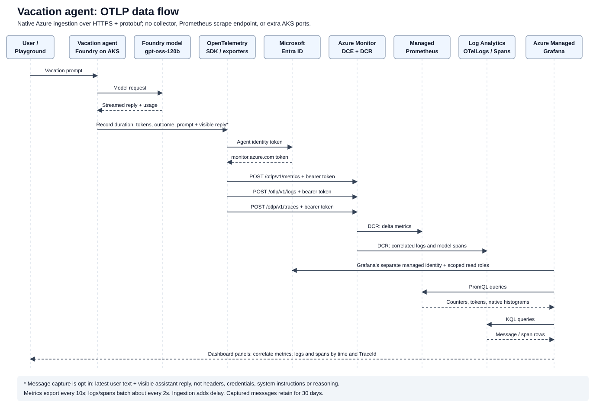

# Foundry BYO AKS observability demo

A vacation-planning hosted agent demonstrates OpenTelemetry on Microsoft Foundry with a customer-managed AKS cluster. It sends metrics, logs, and spans directly to Azure Monitor using authenticated OTLP over HTTPS. Azure Managed Grafana displays the results.



## What this demonstrates

- The agent instruments model calls in `src/vacation-planner/main.py` and exports telemetry from `telemetry.py`.
- Azure Monitor routes OTLP metrics to an Azure Monitor workspace for Managed Prometheus, and logs and spans to Log Analytics. No collector or Prometheus scrape endpoint is required.
- Grafana queries both destinations. `scripts/build_dashboard.py` generates a 10-panel dashboard with metrics, request/response logs, and correlated model spans.
- `scripts/generate_traffic.py` produces a bounded batch of synthetic two-turn conversations.

## Privacy and costs

Message content capture is **disabled by default**. When enabled, the agent stores the latest user message and the visible model response in Log Analytics. Do not send secrets or real personal information; restrict who can read the workspace and Grafana. Previously uncaptured messages cannot be recovered from telemetry.

The sample monitoring template configures 30-day Log Analytics retention and a 1-GB daily cap. Review the retention, cap, networking, and access policies for your environment. The template creates billable resources, including Azure Managed Grafana; model calls and telemetry ingestion can also incur charges. This is a demo, not a production security configuration.

## Prerequisites

- An existing Foundry project configured for hosted agents on customer-managed AKS, a model deployment, and an Azure Container Registry accessible to that project.
- Azure CLI, Azure Developer CLI (`azd`) with its Foundry agents extension, and access to provision monitoring resources and assign roles.
- Python 3.12 or later. On Windows, install the pinned dependencies with `pip install -r .\src\vacation-planner\requirements.txt`.
- An authenticated Azure CLI and azd identity with access to the intended subscription.

The monitoring template provisions only monitoring resources; it does **not** create AKS, Foundry, the model, or ACR. A newly cloned repository has no Azure environment configured. Do not run `azd provision` expecting this sample to create the Foundry stack.

## 1. Create the monitoring resources

Create or select a resource group. In the following PowerShell example, replace the values with your own before running it:

```powershell
$monitoringGroup = 'YOUR_MONITORING_RESOURCE_GROUP'
$location = 'eastus2'
$suffix = 'UNIQUE8' # 1-8 characters; choose an Azure-compatible unique suffix

az deployment group create --resource-group $monitoringGroup `
  --name vacation-observability --template-file .\infra\monitoring.json `
  --parameters location=$location suffix=$suffix
```

Record the deployment outputs: `monitorWorkspaceId`, `logWorkspaceId`, `appInsightsId`, `dcrId`, `dcrImmutableId`, `logsIngestion`, and `metricsIngestion`. The Grafana resource is named `graf-vacation-<suffix>`.

## 2. Configure and deploy the agent

Initialize an azd environment (`azd env new`) and bind it to your **existing** Foundry project and registry with `azd env set`. Configure the following values for your environment. `AZURE_RESOURCE_GROUP` is the group containing the existing Foundry project, not necessarily the new monitoring group.

| Environment value | Meaning |
|---|---|
| `AZURE_SUBSCRIPTION_ID`, `AZURE_TENANT_ID`, `AZURE_LOCATION` | Subscription, tenant, and Foundry region |
| `AZURE_RESOURCE_GROUP`, `AZURE_AI_ACCOUNT_NAME`, `AZURE_AI_PROJECT_NAME` | Existing Foundry resource group, account, and project |
| `AZURE_AI_PROJECT_ID` | Existing Foundry project's ARM resource ID |
| `AZURE_AI_PROJECT_ENDPOINT`, `FOUNDRY_PROJECT_ENDPOINT` | Existing Foundry project endpoint URL |
| `AZURE_CONTAINER_REGISTRY_ENDPOINT` | Registry endpoint for remote container builds |
| `AZURE_AI_MODEL_DEPLOYMENT_NAME` | Existing model deployment name |
| `DEMO_OTLP_METRICS_ENDPOINT`, `DEMO_OTLP_LOGS_ENDPOINT`, `DEMO_OTLP_TRACES_ENDPOINT` | Fully qualified ingestion URLs shown below |

Consult the [hosted agent documentation](https://learn.microsoft.com/azure/ai-foundry/agents/concepts/hosted-agents) for project and BYO AKS prerequisites. Keep the resulting `.azure` environment private; it is ignored by Git.

Use the DCR immutable ID and DCE ingestion endpoint outputs from step 1 to set:

```text
DEMO_OTLP_METRICS_ENDPOINT = <metricsIngestion>/datacollectionRules/<dcrImmutableId>/streams/Custom-Metrics-Otel/otlp/v1/metrics
DEMO_OTLP_LOGS_ENDPOINT   = <logsIngestion>/datacollectionRules/<dcrImmutableId>/streams/Microsoft-OTLP-Logs/otlp/v1/logs
DEMO_OTLP_TRACES_ENDPOINT = <logsIngestion>/datacollectionRules/<dcrImmutableId>/streams/Microsoft-OTLP-Traces/otlp/v1/traces
```

For example, use `azd env set` for each environment value. Set `AZURE_AI_MODEL_DEPLOYMENT_NAME` to your model deployment, and set `AZD_ALPHA_ENABLE_AGENTS_BYO_AKS=true` in the process environment if your azd extension requires it. Then deploy with `azd deploy`.

After deployment, the agent's managed identity needs **Monitoring Metrics Publisher** on the DCR and model-inference access to the Foundry account. A project-scoped model role alone may not be sufficient for the account endpoint. Grant only the scopes required by your environment.

To opt in to message capture, change `DEMO_CAPTURE_MESSAGES` in `azure.yaml` to `'true'` and deploy a new agent version. The original deployed version and older sessions do not automatically change. Use only synthetic prompts and appropriate access controls.

## 3. Connect Grafana

Give Grafana's managed identity monitoring read access to the Azure Monitor workspace and Log Analytics read access to the workspace. Grant intended users access to the Grafana workspace. Role assignments can take time to propagate.

Create these two Grafana data sources using managed identity:

| Data source | UID | Configuration |
|---|---|---|
| Prometheus | `vacation-prometheus` | Azure Monitor workspace Prometheus query endpoint |
| Azure Monitor | `vacation-azure-monitor` | Your Azure subscription |

`infra/prometheus-datasource.json` and `infra/logs-datasource.json` are templates; replace their placeholder values in **local copies**, not the checked-in files. Create the sources using the Grafana UI or `az grafana data-source create`.

Generate and import the dashboard using your Log Analytics **ARM resource ID**, not its workspace/customer ID:

```powershell
python .\scripts\build_dashboard.py --log-analytics-workspace-id $logWorkspaceId
az grafana dashboard create --resource-group $monitoringGroup --name $grafanaName `
  --definition .\infra\dashboard.json --overwrite true
```

Set `$logWorkspaceId` and `$grafanaName` to the values for your deployment. The generated dashboard contains your workspace ID and is ignored by Git.

## 4. Try the demo

Invoke the deployed version in the Foundry Playground or with `azd ai agent invoke`. For an automated, bounded batch of 24 requests, run `python .\scripts\generate_traffic.py --version <deployed-version>` after selecting the azd environment. It creates a new session, saves session and response IDs locally in the ignored `traffic-results.json`, and stops after three consecutive failures. Model usage is billable.

Select a recent time range in Grafana. The request/response table shows message content only for capture-enabled versions and sessions. Metrics are exported about every 10 seconds and logs/spans are batched about every two seconds; ingestion may take longer. `scripts/verify_dashboard.py` can query the generated dashboard against your Grafana endpoint with `--grafana-url` and `--subscription-id`; it expects recent data in every panel.

## Files

| Path | Purpose |
|---|---|
| `azure.yaml` | Hosted-agent deployment and telemetry settings |
| `src/vacation-planner/` | Agent, OpenTelemetry exporter, container, and focused tests |
| `infra/monitoring.json` | ARM template for monitoring resources and OTLP routing |
| `infra/*-datasource.json` | Grafana data source templates |
| `scripts/` | Dashboard generation, verification, and synthetic traffic |

Run the local capture tests with:

```powershell
python -m unittest discover -s .\src\vacation-planner -p test_message_capture.py -v
```
